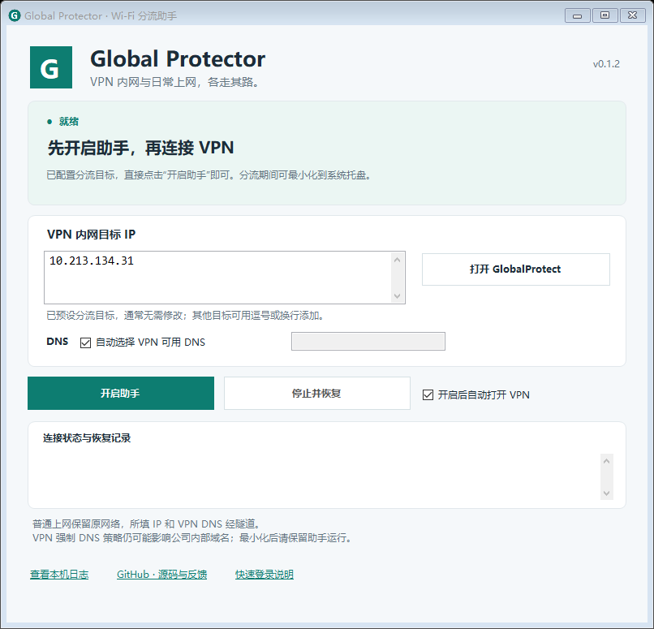
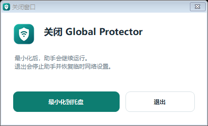
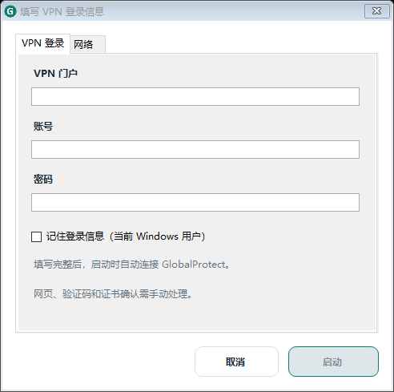

# Global Protector WiFi

轻量、免安装的 Windows 分流助手，让 GlobalProtect 远程访问与日常上网并行。



## 下载与使用

在 [最新正式版](https://github.com/ooLemon0-0/Global_Protector_WIFI_User/releases/latest) 下载 `GlobalProtectorWiFi.exe` 或便携 ZIP。源码 ZIP 供开发者构建，不能替代 EXE。当前正式版为 **v1.1.7**。

v1.1.7 内置越南网页中转，并支持上传断线自动重连和续传。

1. 打开助手。v1.0.3 及以上可直接处理已连接的 GlobalProtect。无法确认原网络出口时，按提示断开 VPN 后再启动助手。
2. 默认分流目标为 **`10.213.134.31`**。需要调整时在 **登录设置 → 网络** 中修改目标地址和 DNS；已有配置继续保留。
3. 点击 **启动**。未填写完整时会弹出 VPN 登录窗口，门户、账号、密码均为必填；填完整后才可点击窗口中的 **启动**。取消填写不会启动助手，也不会申请管理员权限或修改网络。
4. 可选 **记住登录信息**，下次在当前 Windows 用户下无需重复填写。允许 Windows 管理员权限提示后，助手自动打开 GlobalProtect、点击连接并尝试填写、提交原生登录窗口，无需勾选自动连接。
5. 需要网页、验证码或证书确认时，按提示手动处理。断网期间，助手仍在本机继续工作。
6. 等待“已连接”。越南定制版会打开远程桌面，按原方式登录 Windows 后，网页自动在本机浏览器打开。可最小化到系统托盘，**保留助手运行**。
7. VPN 中途掉线时，助手先清理本次分流，再进入等待重连状态。GlobalProtect 重连后，助手重新检测并应用分流。
8. 点击 **停止** 或 **退出并恢复** 会先请求 GlobalProtect 断开。分流发生致命错误时也执行同一流程。如果官方客户端要求确认，助手会显示 **请手动断开 VPN**。断开后自动清理。

### 越南网页

- 匹配越南 VPN 门户和目标 `10.213.134.31` 时，定制版会释放内置的本机组件。另一台 Windows x64 电脑直接使用同一个 EXE，无需预先设置本机端口映射。
- 远端需安装一次中转，并使用安装时的 Windows 账号。已安装的目标继续使用原来的后台中转；需要时从工具托盘菜单选择 **保存远端中转安装包…**。
- 若已有远程桌面窗口没加载插件，关闭该窗口后在助手内点 **打开越南网页**。会话保持连接时可在本机打开 `http://127.0.0.1:23180/`。
- **打开默认站点** 对应 `http://127.0.0.1:23181/`，远端目标为 `http://10.214.1.18/`。
- **传到远程桌面** 将文件保存到 Windows 远程桌面 `10.213.134.31` 的 `桌面\Vietnam Inbox`。进度以远程端确认的接收字节数为准，确认保存后文件会移出队列。
- **暂停与续传** 远端中转 v5 支持断点续传。保持传文件窗口打开，断线后助手会自动等待通道恢复，并从远端保留的进度继续；如果远程桌面窗口已退出，助手会在目标可达后重新打开，遇到 Windows 登录提示时按平时方式登录。点击 **暂停** 可停止自动重试，点 **继续上传** 恢复。关闭窗口后，可重新选择同一路径、内容未变的文件继续。旧版远端中转需要升级才能自动续传。
- **打开现场 SSH** 通过 `127.0.0.1:23222` 转接到 `cisdi@10.214.1.18` 的 SSH 端口。使用原有 SSH 登录方式，远端中转需支持现场 SSH。

启动时自动打开 GlobalProtect 和辅助登录固定启用，没有关闭选项。设置和日志入口位于窗口底部；停止、退出和恢复网络无需重新填写登录信息。

## 关闭窗口



点击窗口右上角关闭按钮或按 Alt+F4 时，选择 **最小化到托盘** 或 **退出**。最小化保留助手运行，双击托盘图标可重新打开；退出会先停止工作并恢复临时网络设置。按 Esc 或关闭选择窗口可取消操作。若网络恢复失败，助手保留运行并提示恢复。

## 检查更新

- 每次启动后在后台自动检查本仓库最新的正式 Release，忽略预发布版和草稿，只提示版本号高于当前版本且已提供 EXE 的版本。
- 发现新版时，窗口底部显示 **发现新版本**；在托盘中运行时同时显示通知。点击入口打开本仓库的版本下载页。也可在窗口底部或托盘菜单中手动 **检查更新**。
- 网络请求有超时限制；断网、GitHub 不可达或接口限流时，自动检查安静结束，不阻止登录、不改变网络，也不打断 VPN。
- 更新检查只请求公开的 GitHub 发布信息，不读取或发送 VPN 门户、账号、密码。程序不自动运行下载文件或覆盖运行中的 EXE。
- 下载新版后，在当前会话结束时停止并退出旧版，再替换 EXE；本机设置和加密登录信息继续保留。

## 辅助登录与凭据保存



- 在登录设置中预输入门户、账号、密码；密码框遮挡输入。缺少任意一项均不能继续启动。
- 启动助手会自动打开已安装的 GlobalProtect，点击连接、识别原生账号密码窗口、填写并提交一次。兼容 GlobalProtect 5.2 原生登录控件；旧版的自动连接关闭设置不再生效。
- 仅接受与当前配置相同的门户，目标程序必须是官方服务所指向、签名有效且签发组织为 Palo Alto Networks 的 PanGPA.exe，并且运行在相同 Windows 用户和会话中。不会把密码填入浏览器或其他进程。
- 网页 / SAML、验证码 / MFA、代理密码和不明确的窗口交回用户处理。证书确认不会自动接受，需用户自行核验；确认后若出现兼容的原生登录窗口，可继续填写。
- 每轮最多提交一次用户名和密码，不会反复尝试错误密码。VPN 断开后的待命阶段不会擅自点击连接；用户手动发起重连时可以继续处理新的原生登录窗口。
- 勾选“记住登录信息”后，门户、账号和密码通过 Windows DPAPI **CurrentUser** 加密保存在本机；不勾选则只在本次助手会话中保留。UAC 提权使用一次性加密交接文件，命令行只包含随机会话 ID。
- 不读取 GlobalProtect 已保存的密码，不把凭据写入 settings.json、PowerShell 参数、日志或仓库。加密资料不能直接复制到另一 Windows 用户或另一电脑使用。

这是 UI 兼容辅助功能，不是 Palo Alto 官方登录 API。已在本机 GlobalProtect 5.2.2 原生窗口实测自动点击连接、填写用户预存的账号密码及提交登录，并得到用户确认；门户绑定、加密存储与异常决策另有模拟测试。不同版本的窗口仍可能不同，不能识别时显示登录失败并记录诊断原因，不反复提交密码。

也可使用 GlobalProtect 官方的 [Save User Credentials / SSO 设置](https://docs.paloaltonetworks.com/ngfw/help/10-1/globalprotect/network-globalprotect-portals/globalprotect-portals-agent-configuration-tab/globalprotect-portals-agent-authentication-tab)，具体取决于公司策略。

GlobalProtect 需预先安装。程序未进行商业代码签名，请校验发布页 SHA-256，不需要关闭防病毒软件。

## 工作原理

- 自动识别 GlobalProtect 的 PANGP 虚拟网卡，以及连接前的物理 Wi-Fi / 以太网默认路由。
- 为默认或自定义的每个远程 IP 添加临时 `/32` 主机路由，经 VPN 访问。默认目标在 `src/Program.cs` 的 `Program.DefaultTarget` 中配置；清空输入后点击开启也会使用默认目标。
- 只移除 GlobalProtect 的 IPv4 默认路由，保留原物理网络默认路由。**其他已由 VPN 下发的内网路由保留**。
- 从 VPN 下发且具有隧道路由的 DNS 中重试选取可解析公网域名的服务器。也可指定其中一个 DNS。
- 自动模式下，如果 VPN DNS 不可用，会验证原 Wi-Fi 或有线网卡已配置的 DNS 是否可用且确实通过该网卡，再临时用于 VPN 网卡。依赖 VPN DNS 的内网域名可能受影响。
- 记录快照，再执行临时修改。检查实际路由、公网连接和 DNS。运行中若只有 DNS 失败，保留已验证的路由并继续检查。路由异常或持续无法连接公网 IP 时恢复原配置。
- GlobalProtect 加回同一条默认路由时，先观察它是否自行消失。确认原网关、同一 VPN 会话和内网目标路由仍然有效后，仅重新移除这条 VPN 默认路由并复查连接。路由持续被加回时停止自动修复，恢复本次临时设置。

工具不修改 GlobalProtect 安装文件、服务端策略、Wi-Fi DNS 或 FlClash 设置，不安装驱动、后台服务或开机启动项。界面是原生 WinForms，PowerShell 工作程序嵌入在单个 EXE 内，运行时提取至本机数据目录。

## 兼容范围与边界

- Windows 10 1903+ / Windows 11，.NET Framework 4.8+，Windows PowerShell 5.1。现代 Windows 通常已内置这些组件。主构建为 AnyCPU；目前在 Windows x64 进行构建和界面检查，x86/ARM64 尚未实机验证。
- 需要当前账号能够以管理员身份运行。公司设备策略可能禁止修改路由或 DNS，此时应联系管理员。
- 初版支持一个 PANGP 网卡和 IPv4 默认路由。多个 PANGP 网卡、IPv6 隧道默认路由、半默认路由会停止操作，不盲目修改。
- 本地逻辑根据一套已成功实测的 GlobalProtect 配置改编，**不能保证所有公司的 VPN 策略都兼容**。公开版的自动 DNS 选择、多目标及 GUI 仍需要更多环境实测。
- VPN 强制 DNS 策略仍可能影响公司内部域名。需要完整的企业内外 DNS 分流时，应由 VPN 管理员配置 Split Tunnel / Split DNS；不能仅靠本工具解决所有环境。
- 远程桌面高延迟、UDP 被阻止、带宽或服务器负载问题不会被分流助手自动修复。
- 初版公网健康检查使用 `1.1.1.1:443` 与 `example.com`。若网络阻止这些检测目标，可能无法通过验证。

## 恢复与日志

本机数据位于 `%LOCALAPPDATA%\GlobalProtectorWiFi\`：

- `events.jsonl`：状态、检测与错误记录。
- `login-diagnostic.jsonl`：自动连接、控件识别、填写与提交的阶段记录，不记录账号、密码或输入框的值。
- `state.json`：恢复快照。
- `settings.json`：本机保存的目标地址及 DNS 选项。
- `login-profile.dpapi`：仅在用户选择记住登录信息时保存的加密凭据。
- `handoff-*.dpapi`：UAC 提权的一次性交接资料，读取后删除。

异常关闭后，再次开启助手会识别未完成的快照。先断开 VPN，再点击 **停止**。不要删除数据目录后再尝试恢复，也不要同时运行旧版脚本和 EXE。

日志不自动上传。提交 Issue 前自行检查并脱敏 IP、网关、DNS 与本机路径。仓库与 Release 不包含个人配置或运行记录。

## 从源码构建

在 Windows PowerShell 中运行：

```powershell
.\build.ps1 -Test
```

输出为 `dist/GlobalProtectorWiFi.exe`。使用 Windows 自带 C# 编译器，不需要 NuGet、Node.js、Python 或额外的 .NET SDK。`src/Engine.ps1` 作为资源嵌入。

构建与正式 Release 相同的内置中转版时，在 Windows 的 PowerShell 7 中运行以下命令。`relay/` 包含中转源码和与现有远端安装兼容的 RDP 插件。

```powershell
$relay = Join-Path $PWD 'tests/bin/relay'
.\relay\Build.ps1 -OutputDirectory $relay
.\build.ps1 -Test -VietnamRelayDirectory $relay
```

`assets/logo.svg` 为矢量 Logo，`assets/app.ico` 包含 16～256 像素的九种 Windows 图标尺寸，并嵌入 EXE、窗口与托盘。修改图形后可运行 `./tools/Build-Branding.ps1` 重新生成 PNG 和 ICO；图形渲染源码位于 `tools/BrandRenderer.cs`。

测试使用模拟网卡、路由和 DNS，验证修改范围、事务回退、重复 DNS、输入校验与异常状态；**不会对测试机器执行真实网络修改**。界面可用 `GlobalProtectorWiFi.exe --demo` 只读预览。

正在运行开发版时，可用 `./build.ps1 -Test -OutputDirectory ./dist/next` 将新版构建到另一目录，保留现有进程。

GitHub Actions 会在推送时构建和测试；推送 `v*` 标签时构建带校验和的 EXE、便携 ZIP、源码 ZIP，并创建 Release。GitHub 自带的 Source code 下载也可使用。

## English

A small portable Windows companion for GlobalProtect. It keeps the physical internet default route, adds selected IPv4 target routes through the VPN, and chooses a working VPN-provided DNS server. It retains other VPN-provided routes, needs administrator rights to change networking, and must remain running for restoration. It is not an official Palo Alto Networks product and cannot override every corporate policy. Starting requires a portal, username and password; missing details open a mandatory login dialog before elevation or network changes. Native-dialog login assistance is always enabled, portal-bound and limited to a verified vendor-signed client under the same Windows user. Credentials entered by the user can be stored locally with Windows DPAPI CurrentUser; they are not logged or uploaded. Browser/SAML, MFA and certificate decisions remain manual. Startup update checks fetch public GitHub release metadata in the background; only newer stable releases are offered, without sending VPN credentials or replacing a running application. No telemetry is collected.

## License

MIT. This independent project is not affiliated with or endorsed by Palo Alto Networks.
